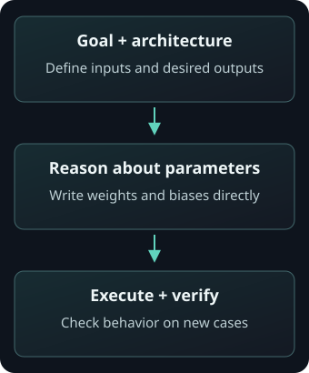

# Proposal: understand weight-space programming

Status: concept proposal for discussion, requested on 2026-11-16. This note
explains the idea; it does not propose a Tempo implementation or experiment.

## The concept

Weight-space programming treats a neural network's weights and biases as
something to inspect and edit directly. An LLM reasons about the intended
behavior and writes parameter values, rather than delegating that edit to
gradient-based training. The authors of
[Sparks of Weight-Space Programming](https://rikiyat.github.io/blog/weight-space-programming/)
describe three activities: reading what a network does, fixing an existing
network, and constructing one from a specification.

In [Figure 1](#figure-1-direct-parameter-writing), writing parameters comes
before checking whether the resulting behavior actually meets the goal.

### Figure 1: direct parameter writing



Figure 1. Conceptual workflow, authored for this note. Arrows mean information
flow, not a measured performance improvement. Evaluation may reveal that the
written parameters do not implement the intended behavior.

The programmer needs the architecture, activations and input/output meanings:
the same list of numbers can mean different things in different networks.
The program is the network computation together with its parameters, not
the parameter file alone.

## A tiny example

Suppose the desired behavior is: return zero up to an input of two, and return
the excess above two afterward. A single ReLU neuron can do this with weight
one and bias minus two. Those values can be written from the rule rather
than fitted from examples.

Original illustrative arithmetic, checked with Python; this is not a Tempo
model or a research benchmark:

```python
def neuron(x):
    return max(0, 1 * x - 2)

assert [neuron(x) for x in (1, 2, 5)] == [0, 0, 3]
```

This deliberately simple construction illustrates direct parameter writing.
It does not show that an LLM can reliably understand or repair a large model.

## How it differs from nearby ideas

| Approach | How the parameters are obtained |
|---|---|
| Ordinary fitting | An optimizer adjusts parameters using a loss on data |
| A trained parameter-generating network | A learned mapping produces parameters from inputs |
| Weight-space programming | A programmer reasons about and directly writes or edits parameters |

[HyperNetworks](https://arxiv.org/abs/1609.09106) exemplifies learned parameter
generation. Our [neural FSRS proposal](neural-fsrs-weights.md) borrows that
idea: train an estimator from history. It is not the same mechanism as asking
an LLM to reason out target weights without training that estimator.

## What the concept does not establish

No gradient training during an edit does not mean no prior training: the LLM
was pretrained, and an edited target may already have been trained. Some
weight-space workflows also use execution feedback. Such feedback is not
automatically forbidden, but repeated candidate selection is still a search
process and needs separate evaluation.

The original report presents early demonstrations, not a general guarantee.
A subsequent [known-rule game study](https://arxiv.org/abs/2611.16981) reports
limits relative to ordinary programs and fragility of written weights in
its tested setting. These are the authors' reported findings, not results
reproduced in Tempo. A persuasive parameter edit still needs behavioral
checks and evidence of generalization beyond the examples used to devise it.

## Possible relevance to Tempo

One discussion direction is reasoning about parameters or constructing a
small network from an explicit scheduling rule. That is a possibility, not
evidence that it would outperform ordinary code or fitting.

Tempo's current FSRS weights are parameters of explicit memory equations,
not a neural-network checkpoint. Asking an LLM to suggest those numbers is
reasoning about model parameters; it would not by itself demonstrate the
neural weight-space capability described above. It also cannot establish
human memory behavior or resolve the
[possible move/line recall mismatch](recall-target-mismatch.md) by explanation
alone. The existing fitting and neural-estimation proposals remain separate.

Sources were checked on 2026-11-16. This concept note runs no model training,
weight editing or performance comparison.
